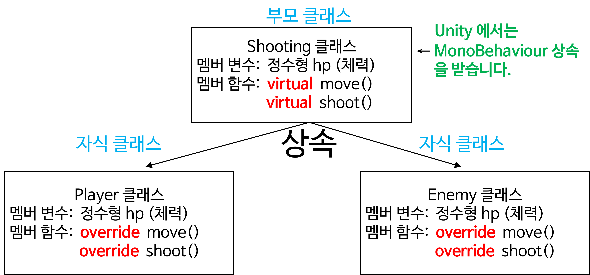

<!--

-->

<!--  -->

## Unity 슈팅게임 2 클래스 설계

게임 화면


Player 와 Enemy 클래스 설계




## 클래스 C# 코드 (기본틀)

> Unity 에서 작성하기 전에 C# 코드의 기본틀을 만듭니다.

> 깃허브(Github)의 [코드스페이스(Codespaces) VS Code](https://github.com/codespaces)에서 작성할 수 있습니다.

**`Shooting.cs` 소스코드: 부모 클래스**
```csharp
using System;

namespace HelloWorld
{
    public class Shooting
    {
        // 멤버 변수
        public int hp = 1;

        // 생성자 멤버 함수
        public Shooting(int my_hp)
        {
            Console.WriteLine("[부모클래스] MonoBehaviour 유니티 객체 상속받음!");
            this.hp = my_hp;
        }
        // 일반 멤버 함수
        public virtual void move()
        {
            Console.WriteLine("비행기가 움직입니다.");
        }
        public virtual void shoot()
        {
            Console.WriteLine("미사일을 쏩니다.");
        }
    }
}

```

**`Player.cs` 소스코드: 자식 클래스 (1)**
```csharp
using System;

namespace HelloWorld
{
    public class Player : Shooting
    {
        // 생성자 멤버 함수
        public Player(int my_hp) : base(my_hp) {}
        // 일반 멤버 함수
        public override void move()
        {
            Console.WriteLine("[자식 Player 클래스] 좌우로 움직인다.");
        }
        public override void shoot()
        {
            Console.WriteLine("[자식 Player 클래스] 위쪽으로 미사일을 쏜다.");
        }
    }
}
```

**`Enemy.cs` 소스코드: 자식 클래스 (2)**
```csharp
using System;

namespace HelloWorld
{
    public class Enemy : Shooting
    {
        // 생성자 멤버 함수
        public Enemy(int my_hp): base(my_hp) {}
        // 일반 멤버 함수
        public override void move()
        {
            Console.WriteLine("[자식 Enemy 클래스] 좌우로 움직이면서 아래로 내려온다.");
        }
        public override void shoot()
        {
            Console.WriteLine("[자식 Enemy 클래스] 아래쪽으로 미사일을 쏜다.");
        }
    }
}
```

**`Example05.cs` 소스코드: 인스턴스 생성**
```csharp
using System;

namespace HelloWorld
{
    public class Example05
    {
        public static void Run()
        {
            Console.WriteLine("\n--- Example 05 실행 ---");
            // 실습 코드를 작성하는 부분
            // 플레이어 비행기 인스턴스 만들기
            Player player = new Player(5);
            // 적 비행기 인스턴스 만들기
            Enemy enemy = new Enemy(1);
            // 게임화면이라는 가정 하에
            // 플레이어 비행기와 적 비행기의 멤버 함수를 호출합니다.
            player.move();
            player.shoot();
            enemy.move();
            enemy.shoot();
        }
    }
}
```

**실행 결과**
```text
--- Example 05 실행 ---
[부모클래스] MonoBehaviour 유니티 객체 상속받음!
[부모클래스] MonoBehaviour 유니티 객체 상속받음!
[자식 Player 클래스] 좌우로 움직인다.
[자식 Player 클래스] 위쪽으로 미사일을 쏜다.
[자식 Enemy 클래스] 좌우로 움직이면서 아래로 내려온다.
[자식 Enemy 클래스] 아래쪽으로 미사일을 쏜다.
```


