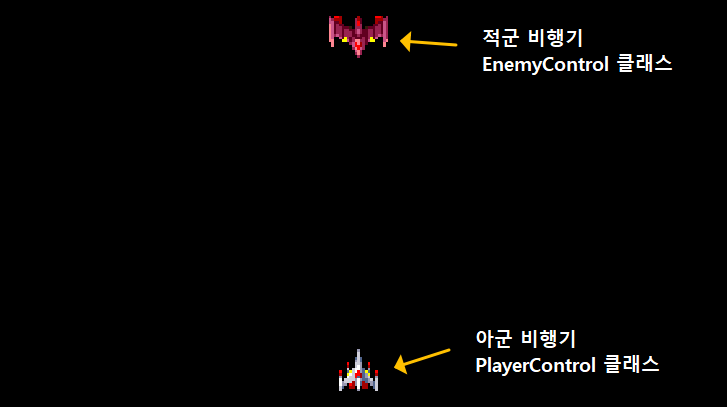
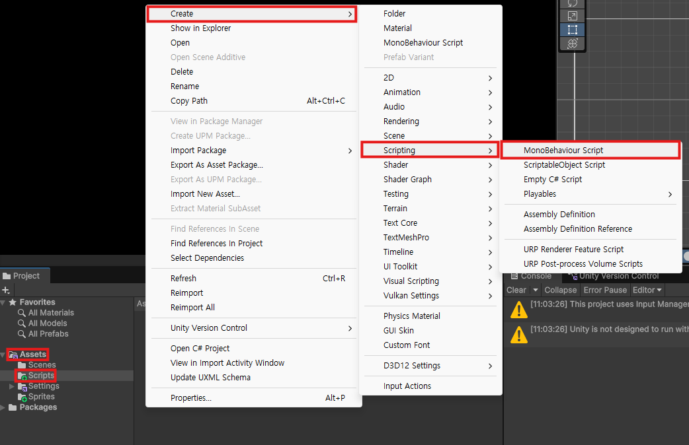

<!--

-->

<!-- 

-->

## Unity 에 Shooting Game 구현하기

### 클래스 다이어그램

**게임 화면**



**클래스 만들기**


### 1. 'Shooting.cs' 부모 클래스 생성하기

`Assets` → `Scripts` 폴더 → `Create` → `Scripting` → `MonoBehaviour Scipt` 클릭

`Shooting.cs` 파일 생성하기



**`Shooting.cs` 소스코드**

```csharp
using UnityEngine;

public class Shooting : MonoBehaviour
{
    // 멤버 변수
    [Header("속도")]
    [Tooltip("비행기 이동 속도입니다.")]
    [SerializeField] public float speed = 0.2f;

    [Header("체력")]
    [Tooltip("최대 체력값 입니다.")]
    [SerializeField] public int maxHp = 1;

    public int currentHp;

    // 멤버 함수
    public virtual void Awake()
    {
        currentHp = maxHp;
    }

    public virtual void TakeDamage(int damage)
    {
        currentHp = currentHp - damage;
    }
    
    public virtual void TakeDamage(int damage, string attackerName)
    {
        TakeDamage(damage);
        Debug.Log($"[{GetType().Name}] {attackerName} 로부터 공격 받음. HP: {currentHp} / {maxHp}");
    }
}
```

### 2.'PlayerControl.cs' 자식 클래스 생성하기 

`Assets` → `Scripts` 폴더 → `Create` → `Scripting` → `Empty C# Script` 클릭

`PlayerControl.cs` 생성하기

**PlayerControl.cs 소스코드**

```csharp
using UnityEditor.Build;
using UnityEngine;

public class PlayerControl : Shooting
{
    // 멤버 함수
    public override void Awake()
    {
        base.Awake();
        maxHp = 5;
        currentHp = maxHp;
    }
    private void Update()
    {
        float moveX = Input.GetAxis("Horizontal");
        Vector3 pos = transform.position;
        pos.x = pos.x + moveX * speed;
        transform.position = pos;
    }
}
```

### 3.'EnemyControl.cs' 자식 클래스 생성하기 

`Assets` → `Scripts` 폴더 → `Create` → `Scripting` → `Empty C# Script` 클릭

`EnemyControl.cs` 생성하기

**EnemyControl.cs 소스코드**

```csharp
using UnityEngine;

public class EnemyControl : Shooting
{
    // 멤버 함수
    public override void Awake()
    {
        base.Awake();
        maxHp = 1;
        currentHp = maxHp;
    }

    private void Update()
    {
        transform.Translate(Vector2.down * (speed * Time.deltaTime), Space.World);
    }
}
```
