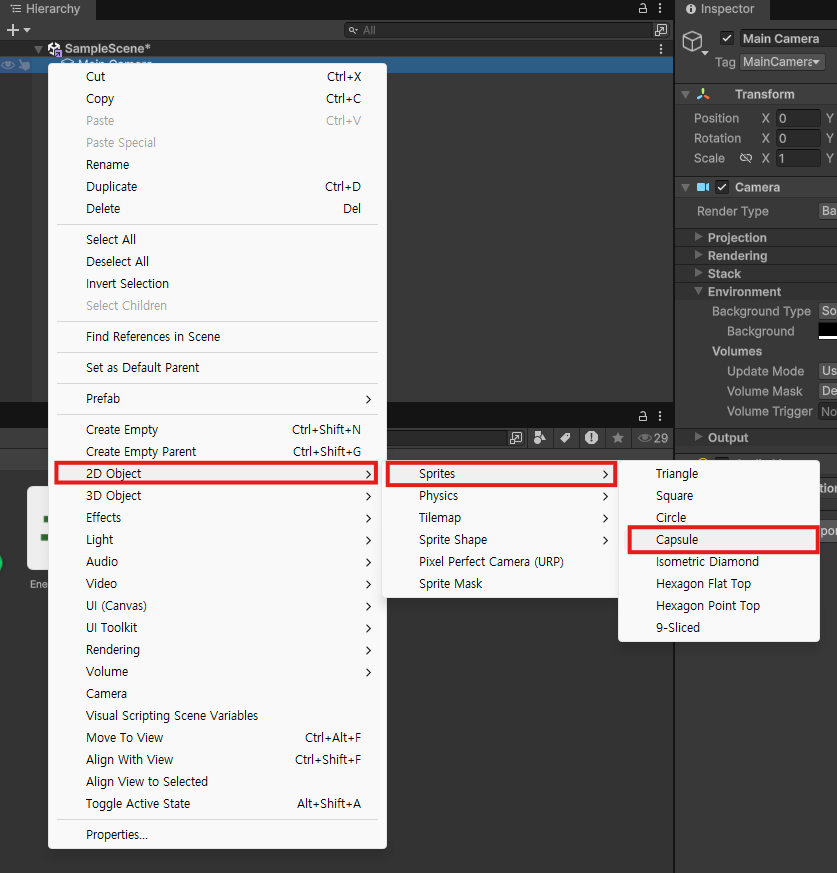
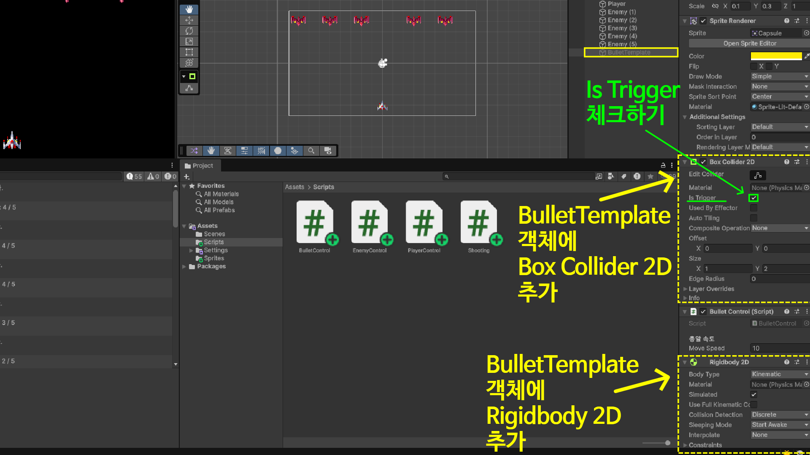
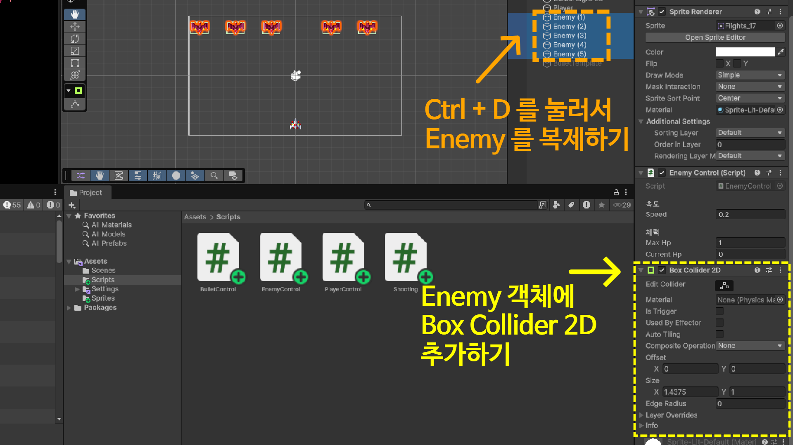
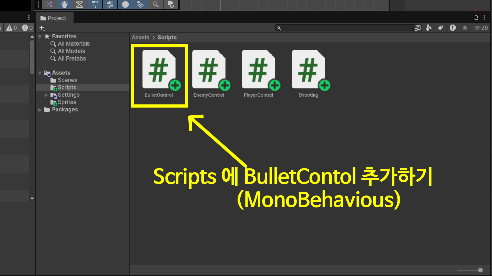

<!--

-->

## 총알 객체(Object) 만들기

총알 생성하기

`Hierarchy` → `2D Object` → `Sprites` → `Capsule` 을 클릭해서 총알을 생성한다.



`Inspector` 에서 총알의 속성을 변경한다.

* 총알 객체의 이름을 `BulletTemplate` 로 바꾼다.
* 체크를 해제해서 비활성화 시킨다. (총알은 1개만 있는 것이 아니고, 계속 복사해서 쓸 것이기 때문이다.)
* 크기를 바꾸기 위해서 `Scale` 을 `x=0.1`, `y=0.3` 으로 변경한다.


## 각 객체에 컴포넌트 연결하기

### 총알(BulletTemplate) 객체

* `Box Collider 2D` 컴포넌트 추가하기 (충돌 감지)
    * **`Is Trigger` 를 꼭 체크해줘야 합니다.**
* `RigidBody 2D` 컴포넌트 추가하기 (물리적인 움직임)



### 플레이어(Player) 객체

* `Box Collider 2D` 컴포넌트 추가하기 (충돌 감지)
* `RigidBody 2D` 컴포넌트 추가하기 (물리적인 움직임)


### 적군 비행기(Enemy) 객체

* 여러개의 적군 비행기를 만들기 위해 `Ctrl + d` 를 눌러서 적군 비행기 객체를 복제한다.
    * 5개의 적군 비행기를 만들려면 4번 `Ctrl + d` 를 눌러서 총 5개의 적군 비행기를 만든다.
* `Box Collider 2D` 컴포넌트 추가하기 (충돌 감지)



## 플레이어(Player) 객체에 총알 연결하기

### 총알을 컨트롤하는 `BulletControl.cs` 생성하기

`Assets` 의 `Scripts` 에 `BulletControl.cs` 추가하기

MonoBehavious 를 상속받아야 합니다.



**`BulletControl.cs` 소스코드**

```csharp
using UnityEngine;

public class BulletControl : MonoBehaviour
{
    // 멤버 변수
    [Header("총알 속도")]
    [Tooltip("총알 이동 속도입니다.")]
    [SerializeField] float moveSpeed = 10.0f;

    // 멤버 함수
    void Update()
    {
        transform.Translate(Vector3.up * moveSpeed * Time.deltaTime, Space.World);

        if (transform.position.y > 6) {
            Destroy(gameObject);
        }
    }

    void OnTriggerEnter2D(Collider2D collision)
    {
        if (collision.CompareTag("Enemy") && collision.TryGetComponent<Shooting>(out var enemy) ) {
            Debug.Log("총알이 Enemy 비행기에 명중했습니다.");
            enemy.TakeDamage(1);
            Destroy(gameObject);
        }
    }
}
```

### 플레이어(Player) 스크립트 수정하기

```csharp
using UnityEditor.Build;
using UnityEngine;

public class PlayerControl : Shooting
{
    // 멤버 변수
    // 총알 만들기
    [Header("총알")]
    [Tooltip("총알로 사용될 게임 객체입니다.")]
    [SerializeField] GameObject bulletTemplate;

    // 멤버 함수
    public override void Awake()
    {
        base.Awake();
        maxHp = 5;
        currentHp = maxHp;
    }
    void Update()
    {
        float moveX = Input.GetAxis("Horizontal");
        Vector3 pos = transform.position;
        // Mathf.Clamp 함수를 사용해서 비행기가 화면 안에서만 움직이게 만듭니다.
        pos.x = Mathf.Clamp(pos.x + moveX * speed, -8, 8);
        transform.position = pos;
        // 키보드 입력이 스페이스바 이면 총알이 발사됩니다.
        if (Input.GetKeyDown(KeyCode.Space)) {
            FireBullet();
        }
    }

    void FireBullet()
    {
        // 기본 위치를 Player 위치로 정한다.
        Vector3 pos = transform.position;
        GameObject bullet = Instantiate(bulletTemplate, pos, Quaternion.identity);
        // 총알을 활성화 시킨다.
        bullet.SetActive(true);
    }
}
```

### 적군 비행기(Enemy) 스크립트 수정하기

```csharp
using UnityEngine;

public class EnemyControl : Shooting
{
    // 멤버 함수
    public override void Awake()
    {
        base.Awake();
        maxHp = 5;
        currentHp = maxHp;
    }

    private void Update()
    {
        transform.Translate(Vector2.down * (speed * Time.deltaTime), Space.World);
    }

    public override void TakeDamage(int damage)
    {
        base.TakeDamage(damage);
        Debug.Log($"[Enemy] 총알에 맞았습니다. 남은 HP: {currentHp} / {maxHp}");
        if (currentHp <= 0) {
            Debug.Log("[Enemy] HP 가 0 이 되서 격추되었습니다.");
            Destroy(gameObject);
        }
    }
}
```