## 프로젝트 준비

### 프로젝트 생성

| 항목 | 값 |
| :-: | :-: |
| 에디터 버전 | 6.3 LTS |
| 타입 | Universal 3D |
| 프로젝트 이름 | 3d-starter |

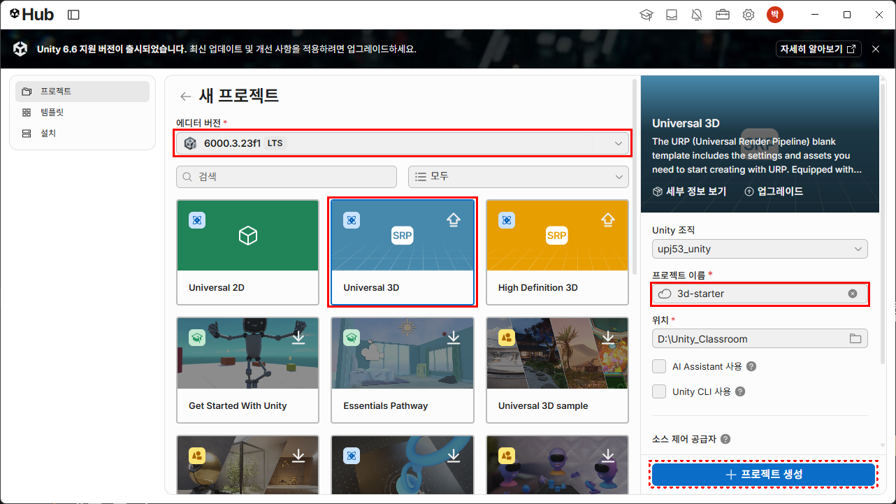

### VS Code 에디터로 설정

* 메뉴: Edit → Preferences ▶ External Tool → External Script Editor : Visual Studio Code

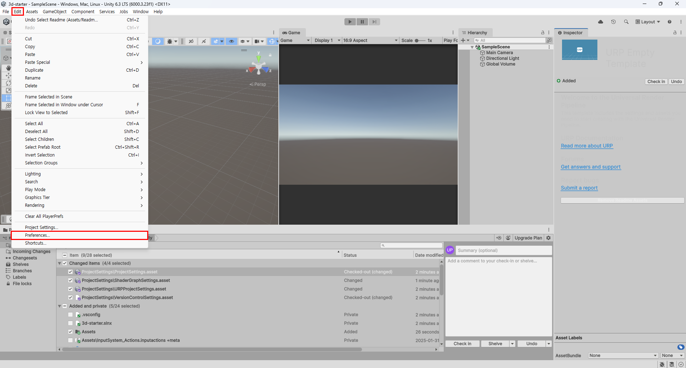

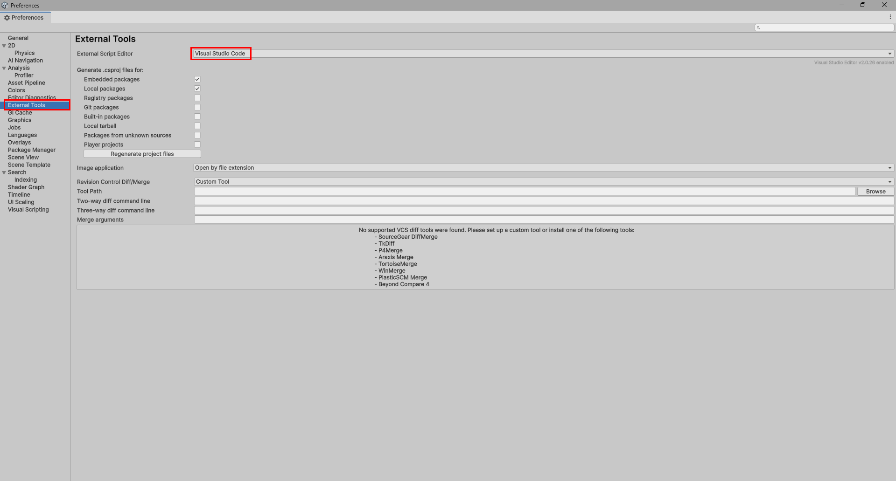


### 키보드 입력 추가

* 메뉴: Edit → Project Settings ▶ Player → Other Settings → Active Input Handling : Both

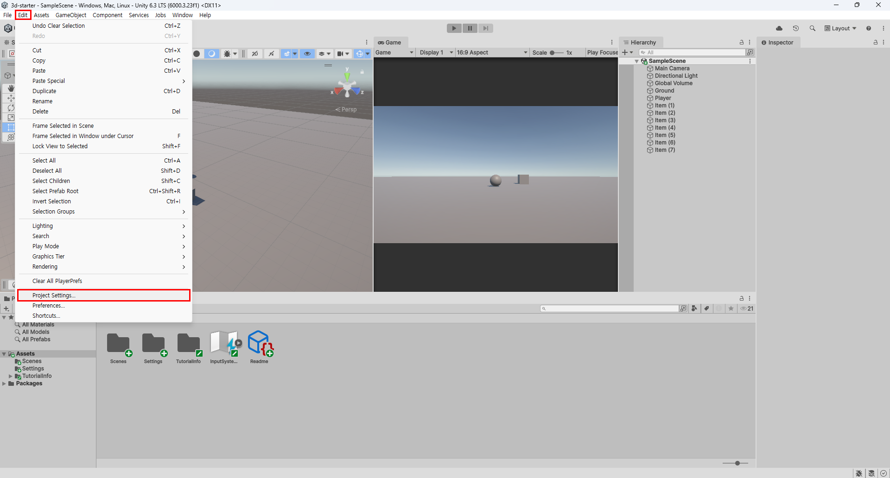

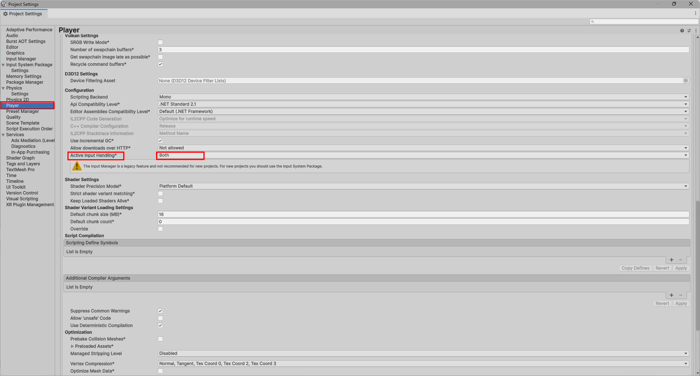


## 게임 오브젝트 만들기

### 1.Ground 만들기

* Hierachy 에서 마우스 우클릭 ▶ 3D Object → Plane
* 이름을 `Ground` 로 변경한다.
* 크기 변경: Scale `X=10`, `Y=10`, `Z=10`


### 2.Player 만들기

* Hierachy 에서 마우스 우클릭 ▶ 3D Object → Sphere
* 이름을 `Player` 로 변경한다.
* Tag 를 `Player` 로 선택한다.
* 위치 변경: Position `X=0`, `Y=0.5`, `Z=0`

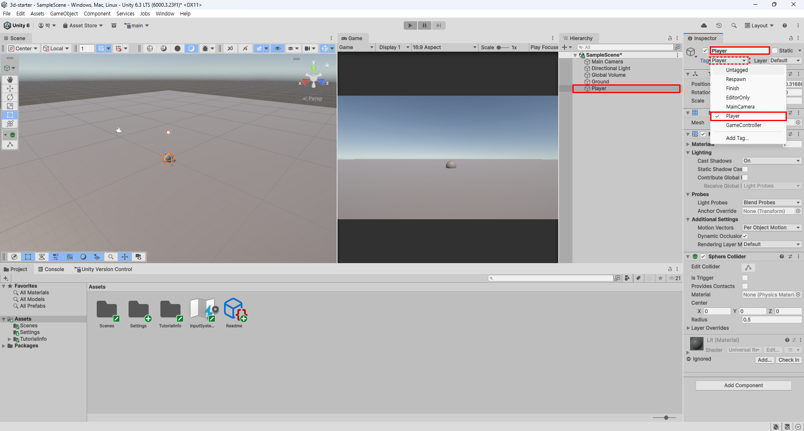

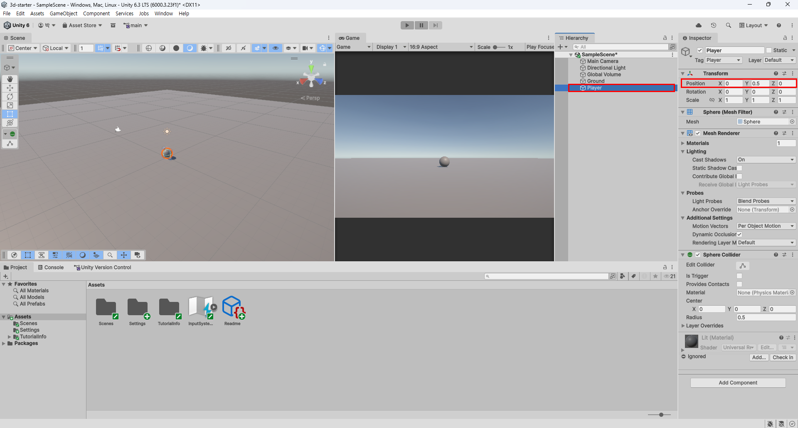

### 3.Item 만들기

**※ 수행평가 때는 Item 1개만 만듭니다.**

* Hierachy 에서 마우스 우클릭 ▶ 3D Object → Cube
* 이름을 `Item (1)` 로 변경한다.
* 새로운 Tag 추가: Tag 의 Add Tag... 를 선택한다.
    * `+` 를 누르고 New Tag Name 에 `Item` 을 입력한 뒤 `Save` 한다.
    * 그리고 다시 Item (1) 객체의 Tag 를 누르고 `Item` 을 선택한다.
* 위치 변경: Position `X=3`, `Y=0.5`, `Z=3`

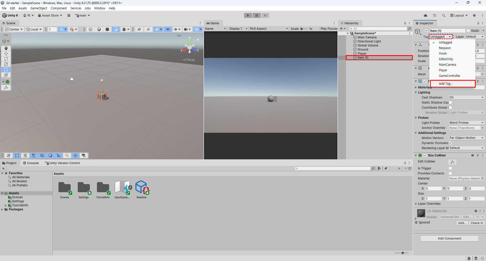

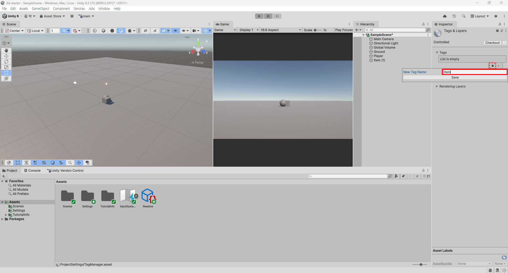

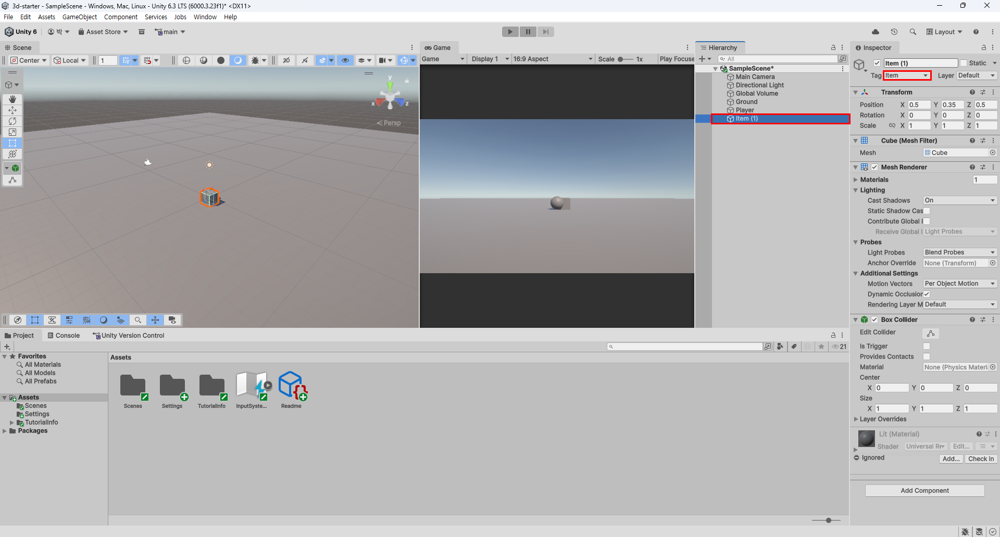

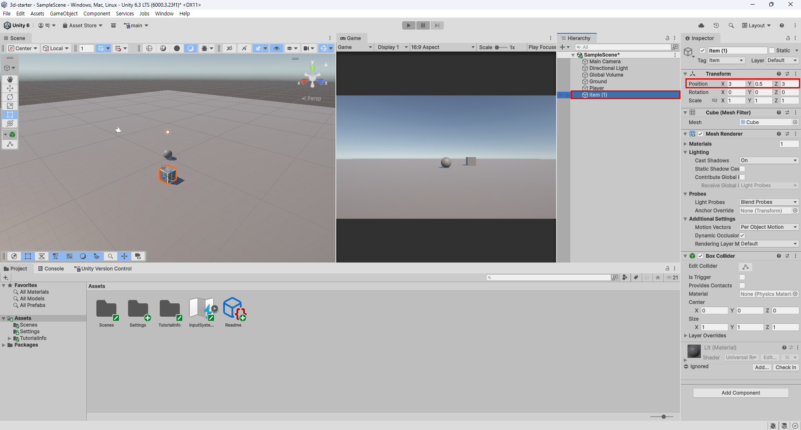

## C# 스크립트 작성

**`PlayerController.cs` 소스코드**

역할: 3D 공을 키보드로 굴리는 클래스

```csharp
using UnityEngine;

public class PlayerController : MonoBehaviour
{
    // =========================================================================
    // [1. 멤버 변수 (Member Variables / Fields) - 객체의 '상태'나 '데이터'를 저장]
    // 
    // [Header]는 유니티 인스펙터 창에서 변수들을 그룹별로 구분할 수 있도록 제목(헤더)을 달아주는 역할을 합니다.
    // [SerializeField]는 private 변수를 보호(캡슐화)하면서도 유니티 인스펙터 창에서 편집할 수 있게 해줍니다.
    // =========================================================================
    [Header("1. 이동 관련 데이터 (멤버 변수)")]
    // [SerializeField]는 private 변수를 보호(캡슐화)하면서도 유니티 인스펙터 창에서 편집할 수 있게 해줍니다.
    [SerializeField] private float moveForce = 8.0f; // 공을 밀어주는 힘의 세기

    [Header("2. 컴포넌트 참조 데이터 (멤버 변수)")]
    // 다른 인스턴스(물리 부품)를 가리킬 참조 변수입니다. 처음에는 비어 있습니다(null).
    private Rigidbody rb;

    [Header("3. 게임 상태 데이터 (멤버 변수)")]
    // 학생이 키보드를 눌렀을 때 입력된 방향값을 기억해 둘 변수입니다.
    private float moveX;
    private float moveZ;

    // 수집한 아이템의 개수를 저장하는 정수형 멤버 변수입니다.
    private int collectedCount = 0;

    // =========================================================================
    // [2. 멤버 함수 (Member Methods) - 객체의 '행동'이나 '기능'을 구현]
    // =========================================================================

    // Start(): 게임이 시작될 때 엔진에 의해 딱 한 번 자동으로 호출되는 초기화 함수
    void Start()
    {
        // 내 게임오브젝트에 부착된 Rigidbody(물리 부품) 인스턴스를 찾아서 rb 멤버 변수에 저장합니다.
        // 이것을 객체지향에서는 "참조(Reference)를 연결한다"고 부릅니다.
        rb = GetComponent<Rigidbody>();

        // 방어적 확인: 만약 Rigidbody 부품을 깜빡하고 안 붙였다면 경고를 출력합니다.
        if (rb == null)
        {
            Debug.LogError("[오류] 플레이어 오브젝트에 Rigidbody 컴포넌트가 없습니다! Inspector에서 추가해 주세요.");
        }
    }

    // Update(): 화면이 새로고침될 때마다(매 프레임) 계속 호출되는 함수 (입력 감지에 적합)
    void Update()
    {
        // 키보드 입력을 읽어서 멤버 변수에 저장합니다.
        // A/D 또는 좌우 화살표: -1.0 ~ +1.0
        moveX = Input.GetAxis("Horizontal");

        // W/S 또는 상하 화살표: -1.0 ~ +1.0
        moveZ = Input.GetAxis("Vertical");
    }

    // FixedUpdate(): 물리 엔진의 고정 주기(초당 50회)마다 호출되는 물리 연산 전용 함수
    void FixedUpdate()
    {
        // Rigidbody 부품이 정상적으로 연결되어 있을 때만 물리 힘을 가합니다.
        if (rb != null)
        {
            // 3차원 공간에서 움직일 방향(X: 좌우, Y: 높이 0, Z: 앞뒤)을 만듭니다.
            Vector3 movement = new Vector3(moveX, 0.0f, moveZ);

            // 물리 부품(Rigidbody)의 멤버 함수인 AddForce()를 호출하여 공을 밉니다.
            rb.AddForce(movement * moveForce);
        }
    }

    // 수행2 내용에 들어가지 않습니다.
    // OnTriggerEnter(): 다른 물체의 영역(Trigger Collider)에 들어갔을 때 엔진이 호출해 주는 함수
    void OnTriggerEnter(Collider collider)
    {
        // 부딪힌 상대방 오브젝트의 태그(Tag)가 "item"인지 확인합니다.
        if (collider.CompareTag("item"))
        {
            // 1) 수집 개수 1 증가 (멤버 변수 데이터 변경)
            collectedCount++;

            // 2) 콘솔 창에 현재 상태 출력
            Debug.Log($"[아이템 획득] 현재 아이템 수: {collectedCount}");

            // 3) 먹은 아이템 오브젝트를 화면에서 제거
            Destroy(collider.gameObject);
        }
    }
}
```

## 수행평가 2 학습 방법

* Unity 프로젝트 용량이 크기 때문에 실습형으로 제출하는데 어려움이 있을 것 같습니다.
* 컴퓨터를 사용할 수 있는 환경에서 서술형, 또는 단답형으로 시험지에 적는 방법으로 수행평가를 보겠습니다.

※ Unity 프로그램을 실행시켜서서 참고할 수 있습니다.

(문제 예시 1) VS Code 에디터로 세팅하는 방법을 Unity 메뉴명을 사용해서 설명하시오.

(문제 예시 2) Inspector 창에서 'Item' 태그를 새로 추가하는 방법을 설명하시오.

(문제 예시 3) 기능구현을 위해 `PlayerController.cs` 소스코드의 빈칸 채우기 문제(ㅇㅇㅇ 기능을 구현하기 위해 `[ ]` 빈칸에 알맞은 C# 코드를 작성하시오.) 나옵니다.


