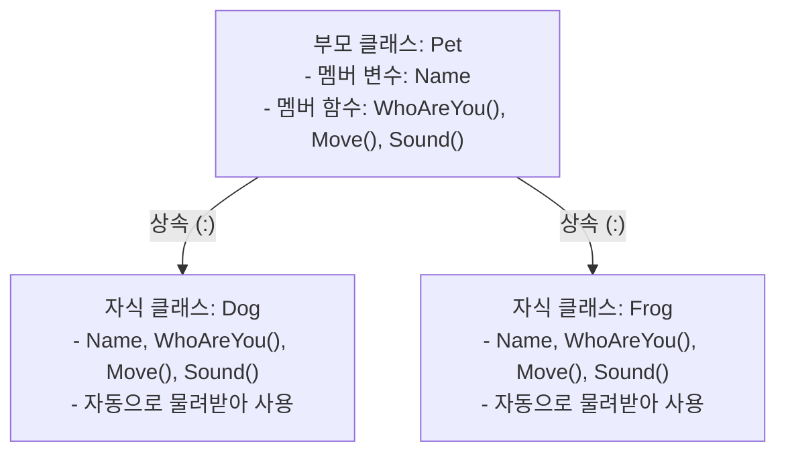
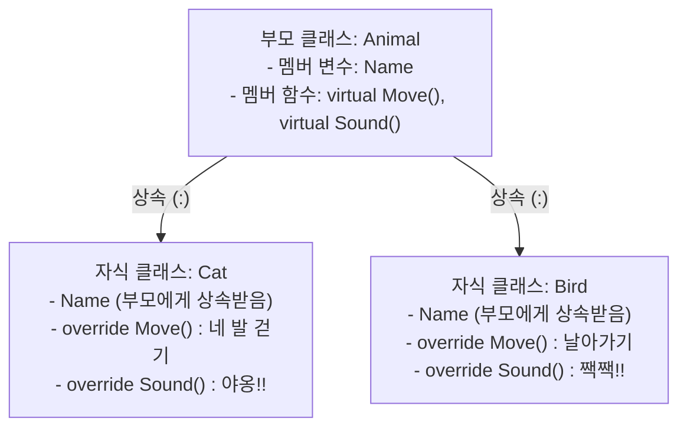

**2026학년도 2학기 응용프로그래밍개발 정기고사 학습 자료**

## 1단원. 개발 도구 및 버전 관리 기초

현대 소프트웨어와 게임 개발은 혼자서 한 번에 완성하지 않고, 여러 번 수정하며 팀원들과 협업합니다. 이때 코드를 안전하게 관리하는 도구가 **Git**과 **GitHub**입니다.

### 1.1 Git (깃)
* **정의:** 리누스 토발즈(Linus Torvalds)가 만든 **버전 관리 시스템(VCS)** 입니다.
* **핵심 특징**
  * **역사 기록:** 소스코드가 언제, 어떻게 수정되었는지 변경 이력을 기록합니다.
  * **타임머신 기능:** 코드에 오류가 생겼을 때 이전의 정상 작동하던 시점으로 쉽게 되돌릴 수 있습니다.
  * **백업 및 협업:** 코드 분실을 막고 여러 개발자가 동시에 작업할 수 있도록 돕습니다.

### 1.2 GitHub (깃허브)와 Codespaces
* **GitHub (깃허브):** Git으로 관리하는 소스코드를 인터넷에 안전하게 보관하고 공유하는 **온라인 코드 저장소(Repository)** 이자 개발자 전용 협업 플랫폼입니다.
* **Codespaces (코드스페이스):** 내 컴퓨터에 무거운 프로그램을 설치하지 않아도, GitHub 웹 브라우저 환경에서 **VS Code(Visual Studio Code)** 를 바로 열어 C# 코드를 작성하고 실행할 수 있는 클라우드 개발 환경입니다.

### 1.3 소프트웨어 개발 도구의 버전 정책과 LTS
유니티(Unity)와 같은 게임 엔진이나 프로그래밍 개발 도구는 지속적으로 기능이 추가되고 수정되며 여러 버전으로 배포됩니다. 실제 프로젝트를 개발할 때는 목적에 맞는 버전을 선택하는 것이 중요합니다.

* **LTS (Long Term Support, 장기 지원 버전)**
  * **정의:** 제작사가 **오랜 기간(보통 2 ~ 3년 이상) 안정적인 업데이트와 버그 수정, 보안 패치를 공식적으로 지원하는 버전** 입니다.
  * **권장 이유:** 새로운 기능 추가보다는 **안정성과 호환성** 에 초점을 맞추어 검증된 버전이므로, 팀 프로젝트나 상용 게임을 개발할 때는 가능하면 **LTS 버전으로 선택 및 업데이트하는 것이 권장** 됩니다.
* **함께 알아두는 소프트웨어 배포·수정 용어**
  * **Alpha (알파, 초기 개발 버전):** 개발 초기 단계에서 내부 테스트를 위해 만든 버전으로, 기능이 불완전하고 버그가 많을 수 있습니다.
  * **Beta (베타, 베타 테스트 버전):** 정식 출시 전 일부 사용자에게 공개하여 오류를 찾고 피드백을 받기 위한 시험 버전입니다.
  * **Demo (데모, 체험판 버전):** 정식 버전을 구매하거나 사용하기 전에 핵심 기능 일부만 미리 체험해 볼 수 있도록 만든 맛보기 버전입니다.
  * **Patch (패치, 임시 수정 파일):** 이미 배포된 소프트웨어의 특정 버그를 고치거나 보안 취약점을 보완하기 위해 부분적으로 덮어쓰는 수정 파일입니다.
* **인과관계 이해:** 개발 중인 프로젝트에 검증되지 않은 `Alpha` 나 `Beta` 버전을 적용하면(원인) 예기치 않은 오류로 작업이 중단될 위험이 큽니다(결과). 반면 `LTS` 버전을 선택하면(원인) 공식적인 장기 기술 지원과 버그 수정을 보장받아 프로젝트를 안정적으로 유지·개발할 수 있습니다(결과).

---

## 2단원. C# 배열 (Array)

### 2.1 배열의 개념과 필요성
* **정의:** **같은 자료형**의 데이터 여러 개를 메모리 공간에 **연속적으로** 묶어서 저장하는 자료구조입니다.
* **인덱스(Index):** 배열 속 각 칸의 번호를 의미합니다. C#에서 배열의 인덱스는 반드시 **0번부터 시작**합니다.
  * 데이터가 5개 들어 있는 배열의 인덱스 범위는 `0 ~ 4`입니다.
  * 마지막 요소의 인덱스는 항상 `배열의 길이 - 1`입니다.
  * 존재하지 않는 인덱스(예: 길이가 5인 배열에서 `5`번 인덱스)에 접근하면 실행 중 오류(`IndexOutOfRangeException`)가 발생합니다.

### 2.2 배열의 선언, 접근 및 값 수정
배열은 자료형 뒤에 대괄호(`[]`)를 붙여 선언하며, 한 번 저장한 값도 인덱스를 지정해 언제든 다른 값으로 바꿀 수 있습니다. 또한 문자열(`string`) 역시 문자들이 연속된 배열과 유사하게 인덱스로 한 글자씩 꺼낼 수 있습니다. 단, 문자열은 인덱스로 읽기는 가능하지만 직접 수정할 수 없습니다.

```csharp
using System;

class Program
{
    static void Main()
    {
        // 1. 정수형 배열 선언 및 초기화 (인덱스: 0, 1, 2, 3, 4)
        int[] scores = { 10, 20, 30, 40, 50 };

        // 인덱스 2번(세 번째 칸)의 값 출력 -> 30
        Console.WriteLine(scores[2]);

        // 인덱스 2번의 값을 99로 수정
        scores[2] = 99;
        Console.WriteLine(scores[2]); // 수정된 값 출력 -> 99

        // 2. 문자열 배열과 일반 문자열의 인덱스 접근
        string[] words = { "A", "B", "C", "D", "E" };
        Console.WriteLine(words[0]); // 첫 번째 요소 -> A
        Console.WriteLine(words[4]); // 마지막 요소 -> E

        string myWord = "ABCDE";
        Console.WriteLine(myWord[0]); // 첫 번째 글자 -> A
        Console.WriteLine(myWord[4]); // 마지막 글자 -> E
    }
}
```

**실행 결과**
```text
30
99
A
E
A
E
```

### 2.3 배열의 길이(`.Length`)와 반복문 활용 (순방향 / 역방향)
* **`.Length` 속성:** 배열 안에 데이터가 몇 개 들어 있는지 일일이 세지 않고, 배열 전체의 크기(개수)를 자동으로 알려주는 속성입니다.
* **순방향 출력:** `i = 0`부터 `i < 배열.Length`까지 `i++`로 증가시키며 처음부터 끝까지 출력합니다.
* **역방향(거꾸로) 출력:** `i = 배열.Length - 1`부터 `i >= 0`까지 `i--`로 감소시키며 끝에서 처음으로 출력합니다.
```csharp
using System;

class Program
{
    static void Main()
    {
        int[] numbers = { 2, 4, 6, 8, 10, 12 };

        // 배열의 전체 개수(6) 출력
        Console.WriteLine($"배열의 크기={numbers.Length}");

        // 1. 순방향 출력 (0번 인덱스 -> 5번 인덱스)
        for (int i = 0; i < numbers.Length; i++)
        {
            Console.WriteLine($"순방향 {i}번={numbers[i]}");
        }

        // 2. 역방향(거꾸로) 출력 (5번 인덱스 -> 0번 인덱스)
        for (int i = numbers.Length - 1; i >= 0; i--)
        {
            Console.WriteLine($"{i}인덱스의 값={numbers[i]}");
        }
    }
}
```

**실행 결과 (역방향 출력 부분)**
```text
배열의 크기=6
(순방향 출력 생략)
5인덱스의 값=12
4인덱스의 값=10
3인덱스의 값=8
2인덱스의 값=6
1인덱스의 값=4
0인덱스의 값=2
```
* **인과관계 이해:** `numbers.Length`가 `6`이므로 `numbers.Length - 1`은 `5`가 됩니다. 따라서 반복문의 첫 번째 실행 시 `i`는 `5`이며, 가장 먼저 `5인덱스의 값=12`가 출력됩니다.

---

## 3단원. 객체지향 프로그래밍(OOP) 개념과 접근 제한자

### 3.1 객체지향 프로그래밍 (OOP: Object-Oriented Programming)
* **정의:** 현실 세계의 물건(객체)처럼 **'데이터(상태/정보)'** 와 **'기능(동작/행동)'** 을 하나의 단위로 묶어서 프로그래밍하는 방식입니다.
* **게임 속 객체지향의 활용**
  * 게임에 등장하는 플레이어, 몬스터, 펫, 아이템, 총알(Bullet) 등을 각각 하나의 **클래스(설계도)** 로 만듭니다.
  * 게임이 실행되면 이 설계도를 바탕으로 게임 화면에 실제로 배치되는 **인스턴스(객체)** 를 생성해 조작합니다.
* **객체지향의 장점:** 코드를 부품처럼 관리하므로 재사용하기 쉽고, 버그를 수정하거나 새 캐릭터를 추가하는 유지보수가 편리합니다.

### 3.2 접근 제한자 (Access Modifiers)와 캡슐화
현실의 스마트폰도 겉면의 버튼(볼륨, 전원)은 누구나 누를 수 있지만, 내부 배터리나 회로는 안전하게 케이스로 감싸 보호합니다. 프로그래밍에서도 중요한 데이터를 보호하기 위해 **외부에서 접근할 수 있는 범위를 제한하는 키워드** 를 **접근 제한자** 라고 하며, 이를 통해 데이터를 안전하게 숨기는 개념을 **캡슐화(Encapsulation)** 라고 합니다.

| 접근 제한자 | 접근 허용 범위 | 쉬운 비유 | 게임 프로그래밍 활용 예시 |
| :--- | :--- | :--- | :--- |
| **`public`** | 어디서나 접근 가능 (클래스 내부 + 외부 + 자식) | 거실 (누구나 이용 가능) | 다른 코드에서 호출해야 하는 공격 함수, 펫의 이름 |
| **`private`** | **자기 자신의 클래스 내부** 에서만 접근 가능 | 개인 비밀 금고 (본인만 열 수 있음) | 해킹이나 오작동을 막아야 하는 내부 체력 계산 변수, 비밀번호 |
| **`protected`** | 자기 자신 + **상속받은 자식 클래스** 에서만 접근 가능 | 가족 공용 금고 (부모와 자식만 사용) | 부모(`Animal`)와 자식(`Cat`, `Bird`)만 공유하고 외부에는 숨길 기본 능력치 |

* **참고:** C# 클래스 내부에서 멤버 변수나 멤버 함수 앞에 접근 제한자를 아무것도 적지 않으면 기본값으로 **`private`** 이 적용됩니다.

```csharp
using System;

public class Player
{
    public string Name = "용사";        // 외부에서 자유롭게 읽고 수정 가능
    protected int Level = 1;            // Player와 이를 상속받은 자식 클래스에서만 사용 가능
    private int secretCode = 9999;      // 오직 Player 클래스 내부에서만 사용 가능

    public void ShowSecret()
    {
        // 같은 클래스 내부이므로 private 변수에 접근 가능
        Console.WriteLine($"내부 보안 코드: {secretCode}");
    }
}

class Program
{
    static void Main()
    {
        Player p = new Player();
        Console.WriteLine(p.Name);      // 정상 실행 (public)
        p.ShowSecret();                 // 정상 실행 (public 함수를 통해 간접 확인)

        // 아래 두 줄은 접근 권한이 없어 컴파일 오류가 발생합니다.
        // Console.WriteLine(p.Level);      // 오류! (protected는 외부 접근 불가)
        // Console.WriteLine(p.secretCode); // 오류! (private은 외부 접근 불가)
    }
}
```

**실행 결과**
```text
용사
내부 보안 코드: 9999
```

---

## 4단원. 클래스와 인스턴스 (객체지향 C# 기초)

### 4.1 클래스(Class)와 인스턴스(Instance)의 관계
* **클래스 (Class):** 객체를 만들기 위한 **설계도(틀)** 입니다. `class` 키워드를 사용하여 정의합니다. 설계도만 그려둔 상태에서는 게임 화면에 캐릭터가 나타나지 않습니다.
* **인스턴스 (Instance / 객체):** 클래스라는 설계도를 바탕으로 `new` 키워드를 사용해 컴퓨터 메모리에 **실제로 찍어낸 실체**입니다. 하나의 설계도로 여러 개의 서로 다른 인스턴스를 만들 수 있습니다.
* **점(`.`) 연산자:** 생성된 인스턴스 내부의 멤버 변수나 멤버 함수에 접근할 때 사용합니다. (예: `mypet.Name`, `mypet.WhoAreYou()`)

### 4.2 클래스 설계 및 인스턴스 생성 예제

```csharp
using System;

namespace HelloWorld
{
    // 1. 클래스 설계 (설계도 정의)
    public class Pet
    {
        public string Name;
        public int Price;

        public void ShowInfo()
        {
            Console.WriteLine($"펫 이름: {Name}, 가격: {Price}골드");
        }
    }

    class Program
    {
        static void Main()
        {
            // 2. 인스턴스 생성 (new 키워드로 실제 객체 2개 생성)
            Pet myPet = new Pet();
            myPet.Name = "Skittles";
            myPet.Price = 500;

            Pet friendPet = new Pet();
            friendPet.Name = "Kiwi";
            friendPet.Price = 800;

            // 3. 각 인스턴스의 멤버 함수 호출
            myPet.ShowInfo();
            friendPet.ShowInfo();
        }
    }
}
```

**실행 결과**
```text
펫 이름: Skittles, 가격: 500골드
펫 이름: Kiwi, 가격: 800골드
```

* **구조 강조:** `class Pet { ... }` 블록 안에 `Name`, `Price`, `ShowInfo()`가 들여쓰기되어 소속되어 있습니다. `myPet`과 `friendPet`은 같은 `Pet` 설계도로 만들었지만, 메모리에 따로 생성되어 각자 다른 이름과 가격을 저장합니다.

---

## 5단원. 멤버 변수와 멤버 함수

클래스 내부는 크게 **멤버 변수** 와 **멤버 함수** 두 가지 요소로 구성됩니다.

### 5.1 멤버 변수와 멤버 함수의 구분
* **멤버 변수 (Member Variable / Field)**
  * 클래스 내부에서 객체의 **상태나 정보(데이터)** 를 저장하는 변수입니다.
  * 예: 플레이어의 체력(`hp`), 이동 속도(`speed`), 점수(`score`), 획득한 코인 수(`coin`), 펫의 이름(`Name`)
* **멤버 함수 (Member Function / Method)**
  * 클래스 내부에서 객체가 수행할 수 있는 **동작이나 기능**을 정의하는 함수입니다.
  * 예: 이동하기(`MoveLeft()`, `MoveRight()`), 소리 내기(`MakeSound()`), 공격하기(`Attack()`), 자기소개하기(`WhoAreYou()`)

### 5.2 생성자 (Constructor)와 `this` 키워드
* **생성자 함수:** `new` 키워드로 인스턴스를 생성할 때 **가장 먼저 자동으로 호출되는 특수한 멤버 함수** 입니다. 주로 객체가 태어날 때 필요한 초기값(이름, 체력 등)을 설정합니다.
  * **규칙 1:** 함수의 이름이 반드시 **클래스 이름과 완전히 동일** 해야 합니다.
  * **규칙 2:** `void`나 `int` 같은 **반환형(Return Type)을 절대 적지 않습니다.**
* **매개변수 (Parameter):** 함수를 호출할 때 외부에서 값을 넘겨받을 수 있도록 괄호 `()` 안에 선언하는 변수입니다.
* **`this` 키워드:** 클래스 내부에서 **자기 자신 인스턴스** 를 가리키는 지시문입니다. 멤버 변수 이름과 매개변수 이름이 비슷하거나 같을 때, 내 클래스의 멤버 변수임을 명확히 구분하기 위해 `this.Name = name;`처럼 사용합니다.

### 5.3 오버로드 (Overload / 오버로딩)
* **정의:** 하나의 클래스 안에서 **함수(또는 생성자)의 이름은 똑같이 유지하되, 매개변수(파라미터)의 개수나 자료형을 다르게 만들어** 상황에 따라 알맞은 함수가 호출되도록 설계하는 방식입니다.
* **장점:** 펫을 만들 때 이름 없이 기본 생성할 수도 있고, 이름만 넣거나 이름과 체력을 함께 넣어서 생성할 수도 있습니다.

```csharp
using System;

namespace HelloWorld
{
    public class Pet
    {
        // 멤버 변수 (데이터)
        public string Name;
        public int Hp;

        // 생성자 1: 매개변수가 없는 기본 생성자
        public Pet()
        {
            this.Name = "이름없음";
            this.Hp = 100;
            Console.WriteLine("기본 펫 객체 생성!");
        }

        // 생성자 2 (오버로드): string 매개변수 1개를 받는 생성자
        public Pet(string name)
        {
            this.Name = name; // this.Name은 멤버 변수, name은 전달받은 매개변수
            this.Hp = 100;
            Console.WriteLine($"객체 생성! 나의 이름은 {Name} 입니다.");
        }

        // 생성자 3 (오버로드): string, int 매개변수 2개를 받는 생성자
        public Pet(string name, int hp)
        {
            this.Name = name;
            this.Hp = hp;
            Console.WriteLine($"객체 생성! 이름: {Name}, 체력: {Hp}");
        }

        // 일반 멤버 함수 (기능)
        public void WhoAreYou()
        {
            Console.WriteLine($"나의 이름은 {Name} 입니다.");
        }
    }

    class Program
    {
        static void Main()
        {
            // 1. 매개변수 없이 호출 -> 생성자 1 실행
            Pet p1 = new Pet();
            p1.Name = "Skittles";
            p1.WhoAreYou();

            // 2. 문자열 1개를 넘겨 호출 -> 생성자 2 실행
            Pet p2 = new Pet("Kiwi");

            // 3. 문자열과 정수를 넘겨 호출 -> 생성자 3 실행
            Pet p3 = new Pet("Dragon", 500);
        }
    }
}
```

**실행 결과**
```text
기본 펫 객체 생성!
나의 이름은 Skittles 입니다.
객체 생성! 나의 이름은 Kiwi 입니다.
객체 생성! 이름: Dragon, 체력: 500
```
* **인과관계 이해:** `new Pet()`처럼 괄호가 비어 있으면 생성자 1이, `new Pet("Kiwi")`처럼 문자열 1개를 넣으면 생성자 2가, `new Pet("Dragon", 500)`처럼 2개의 인자를 넣으면 생성자 3이 자동으로 선택되어 실행됩니다.

---

## 6단원. 객체지향 상속 (Inheritance) 기초

### 6.1 상속의 개념과 문법
로블록스 *Adopt Me!* 게임에는 강아지(`Dog`), 고양이(`Cat`), 개구리(`Frog`), 말(`Horse`) 등 수많은 펫이 있습니다. 모든 펫은 '이름'이 있고 '움직이고', '소리를 낸다'는 공통점이 있습니다. 이 공통 기능을 매번 복사해서 작성하는 대신 한 번만 만들어 물려주는 것이 **상속** 입니다.

* **정의:** **부모 클래스(상위 클래스)** 의 멤버 변수와 멤버 함수를 **자식 클래스(하위 클래스)** 에 물려주어 그대로 공유하고 확장해서 사용하는 기능입니다.
* **C# 상속 기호:** 콜론(`:`)을 사용합니다.
  * 문법: `public class 자식클래스 : 부모클래스`
  * 예시: `public class Dog : Pet` (`Pet`을 부모로, `Dog`를 자식으로 선언)
* **`base` 키워드:** 자식 클래스 내부에서 **부모 클래스** 를 가리킬 때 사용합니다. 특히 자식 생성자에서 부모 생성자를 호출하여 초기화할 때 `: base(name)` 형태로 사용합니다.

### 6.2 상속 구조도 및 기본 구현 예제 (`Pet` -> `Dog`, `Frog`)



<!--
```text
             [ 부모 클래스: Pet ]
             - 멤버 변수: Name
             - 멤버 함수: WhoAreYou(), Move(), Sound()
                   /                \
         (상속 :) /                  \ (상속 :)
                 v                    v
   [ 자식 클래스: Dog ]        [ 자식 클래스: Frog ]
   - Name, Move(), Sound()     - Name, Move(), Sound()
     자동으로 물려받아 사용      자동으로 물려받아 사용
```
-->

```csharp
using System;

namespace HelloWorld
{
    // 부모 클래스
    public class Pet
    {
        public string Name;

        public Pet()
        {
            Console.WriteLine("객체 생성!");
        }

        public Pet(string name)
        {
            this.Name = name;
            Console.WriteLine("객체 생성!");
            Console.WriteLine($"나의 이름은 {Name} 입니다.");
        }

        public void WhoAreYou()
        {
            Console.WriteLine($"나의 이름은 {Name} 입니다.");
        }

        public void Move()
        {
            Console.WriteLine($"{Name}이/가 움직입니다.");
        }

        public void Sound()
        {
            Console.WriteLine($"{Name}이/가 소리를 냅니다.");
        }
    }

    // 자식 클래스 1: Pet을 상속받음
    public class Dog : Pet
    {
        // base()를 통해 부모 클래스(Pet)의 생성자를 호출
        public Dog() : base() { }
        public Dog(string name) : base(name) { }
    }

    // 자식 클래스 2: Pet을 상속받음
    public class Frog : Pet
    {
        // 전달받은 name을 부모 생성자 Pet(string name)으로 넘겨줌
        public Frog() : base() { }
        public Frog(string name) : base(name) { }
    }

    class Program
    {
        static void Main()
        {
            // Dog 인스턴스 생성 (기본 생성자 사용)
            Dog myDog = new Dog();
            myDog.Name = "멍멍이";
            myDog.WhoAreYou();
            myDog.Move();
            myDog.Sound();

            // Frog 인스턴스 생성 (이름을 넘기는 생성자 사용)
            Frog myFrog = new Frog("개굴");
            myFrog.Move();
            myFrog.Sound();
        }
    }
}
```

**실행 결과**
```text
객체 생성!
나의 이름은 멍멍이 입니다.
멍멍이이/가 움직입니다.
멍멍이이/가 소리를 냅니다.
객체 생성!
나의 이름은 개굴 입니다.
개굴이/가 움직입니다.
개굴이/가 소리를 냅니다.
```
* **인과관계 이해:** `Dog`와 `Frog` 클래스 안에는 `Name` 변수나 `Move()`, `Sound()` 함수 코드가 한 줄도 적혀 있지 않지만, `: Pet`으로 상속받았기 때문에 부모의 기능을 그대로 호출할 수 있습니다.

---

## 7단원. 객체지향 상속 심화: 오버라이드 (Override)

### 7.1 오버라이드(Override)의 개념과 필요성
6단원의 예제에서는 강아지와 개구리가 모두 똑같이 `"소리를 냅니다."`라고 출력되었습니다. 하지만 실제 게임에서는 고양이는 `"야옹!!"`, 새는 `"짹짹!!"` 하고 각자 다르게 동작해야 합니다. 이처럼 **부모에게 물려받은 멤버 함수를 자식 클래스가 자신의 특성에 맞게 수정(재정의)해서 사용하는 기능**을 **오버라이드(Override)** 라고 합니다.

### 7.2 필수 키워드 2가지: `virtual` 과 `override`
C#에서 오버라이드가 정상 작동하려면 부모와 자식이 반드시 한 쌍의 키워드를 약속해서 사용해야 합니다.

* **`virtual` (부모 클래스에 작성):** "자식 클래스가 이 함수를 자기 마음대로 수정해도 좋다"라고 **수정 허용 권한을 부여** 하는 키워드입니다.
* **`override` (자식 클래스에 작성):** "부모 클래스의 함수를 내 방식대로 **덮어써서 수정(재정의)** 하겠다"라고 명시하는 키워드입니다.



<!--
```text
               [ 부모 클래스: Animal ]
               - 멤버 변수: Name
               - 멤버 함수: virtual move(), virtual sound()
                     /                      \
                    v                        v
   [ 자식 클래스: Cat ]              [ 자식 클래스: Bird ]
   - 멤버 변수: Name                 - 멤버 변수: Name
   - override move() -> 네 발 걷기   - override move() -> 날아가기
   - override sound() -> 야옹!!      - override sound() -> 짹짹!!
```
-->

### 7.3 오버라이드 구현 예제 (`Animal` -> `Cat`, `Bird`)

```csharp
using System;

namespace HelloWorld
{
    // 부모 클래스
    public class Animal
    {
        public string Name;

        public Animal(string name)
        {
            this.Name = name;
            Console.WriteLine($"{Name} 인스턴스를 생성했습니다.");
        }

        // virtual: 자식에게 수정 권한 부여
        public virtual void Move()
        {
            Console.WriteLine("움직인다..");
        }

        public virtual void Sound()
        {
            Console.WriteLine("소리를 낸다!");
        }
    }

    // 자식 클래스 1: Cat
    public class Cat : Animal
    {
        public Cat(string name) : base(name) { }

        // override: 부모의 Move()와 Sound()를 고양이 방식으로 재정의
        public override void Move()
        {
            Console.WriteLine("네발로 걸어간다..");
        }

        public override void Sound()
        {
            Console.WriteLine("야옹!!");
        }
    }

    // 자식 클래스 2: Bird
    public class Bird : Animal
    {
        public Bird(string name) : base(name) { }

        // override: 부모의 Move()와 Sound()를 새 방식으로 재정의
        public override void Move()
        {
            Console.WriteLine("훨훨 날아서 간다..");
        }

        public override void Sound()
        {
            Console.WriteLine("짹짹!!");
        }
    }

    class Program
    {
        static void Main()
        {
            Cat myCat = new Cat("헬로키티");
            myCat.Move();
            myCat.Sound();

            Bird myBird = new Bird("앵그리버드");
            myBird.Move();
            myBird.Sound();
        }
    }
}
```

**실행 결과**
```text
헬로키티 인스턴스를 생성했습니다.
네발로 걸어간다..
야옹!!
앵그리버드 인스턴스를 생성했습니다.
훨훨 날아서 간다..
짹짹!!
```

### 7.4 시험 핵심 비교: 오버로드(Overload) vs 오버라이드(Override)

| 구분 | 오버로드 (Overload) | 오버라이드 (Override) |
| :--- | :--- | :--- |
| **발생 위치** | **같은 클래스 내부** | **상속 관계** (부모 클래스 <-> 자식 클래스) |
| **함수 이름** | 동일함 | 동일함 |
| **매개변수(파라미터)** | **반드시 달라야 함** (개수 또는 자료형) | **반드시 같아야 함** |
| **사용 키워드** | 별도 키워드 없음 | 부모: `virtual`, 자식: `override` |
| **핵심 목적** | 같은 이름의 함수를 다양한 입력 형태로 편리하게 호출 | 부모에게 물려받은 기능을 자식에 맞게 새로 덮어쓰기 |

---

## 8단원. 게임 프로그래밍 기본 및 유니티(Unity) 핵심 이론

게임은 1초에 수십 ~ 수백 장의 정지 화면(프레임)을 빠르게 연속해서 그려내는 방식으로 움직임을 표현합니다. 따라서 게임 개발자는 **컴퓨터 성능 차이** 를 반드시 이해하고 코드로 제어해야 합니다.

### 8.1 FPS (초당 프레임 수) vs 화면 주사율 (Hz)
두 개념은 비슷해 보이지만 담당하는 하드웨어와 역할이 다릅니다.

* **FPS (Frames Per Second, 초당 프레임 수)**
  * **관련 하드웨어:** **그래픽카드(GPU)** 성능
  * **의미:** 그래픽카드가 1초 동안 화면에 그려낼 수 있는 이미지(프레임)의 장수(데이터 생성량)입니다. 숫자가 높을수록 게임 화면이 부드럽게 계산됩니다.
* **화면 주사율 (Refresh Rate, 단위: Hz)**
  * **관련 하드웨어:** **모니터(디스플레이)** 성능
  * **의미:** 모니터가 1초 동안 화면을 새로 고쳐서 우리 눈에 보여주는 횟수입니다.
  * **일반적인 기준:**
    * `60 ~ 75Hz`: 문서 작업, 웹 서핑 등 일반 사무용
    * `120 ~ 144Hz` 이상: 빠른 화면 전환이 중요한 게이밍용

### 8.2 유니티(Unity)의 `Time.deltaTime`과 프레임 독립성
* **문제 상황:** 고사양 PC는 1초에 100프레임(100 FPS)이 실행되고, 저사양 PC는 1초에 20프레임(20 FPS)만 실행된다고 가정해 봅시다. 만약 매 프레임마다 캐릭터를 `1`씩 이동시키면, 1초 뒤에 고사양 PC 캐릭터는 `100`만큼 날아가고 저사양 PC 캐릭터는 `20`밖에 못 가는 불공정한 문제가 생깁니다.
* **해결책 (`Time.deltaTime`):**
  * **정의:** **이전 프레임에서 현재 프레임까지 걸린 시간(초 단위)** 을 의미합니다.
    * 100 FPS 환경: `Time.deltaTime` = 약 `0.01`초
    * 20 FPS 환경: `Time.deltaTime` = 약 `0.05`초
  * **프레임 독립성 보장:** 이동 거리를 계산할 때 `속도 * Time.deltaTime`을 곱해 주면, 어떤 성능의 컴퓨터에서도 **1초 동안 이동하는 총거리가 항상 동일하게 유지** 됩니다.
    * 고사양 PC (100 FPS): `속도 10 * 0.01초 * 100회 = 1초에 10 이동`
    * 저사양 PC (20 FPS): `속도 10 * 0.05초 * 20회 = 1초에 10 이동`

```csharp
using UnityEngine;

public class PlayerMove : MonoBehaviour
{
    public float speed = 5.0f; // 초당 이동 속도

    // 매 프레임마다 자동으로 호출되는 유니티 기본 함수
    void Update()
    {
        // Time.deltaTime을 곱해 컴퓨터 사양(FPS)과 관계없이 1초에 speed만큼 균일하게 이동
        transform.Translate(Vector3.right * speed * Time.deltaTime);
    }
}
```
